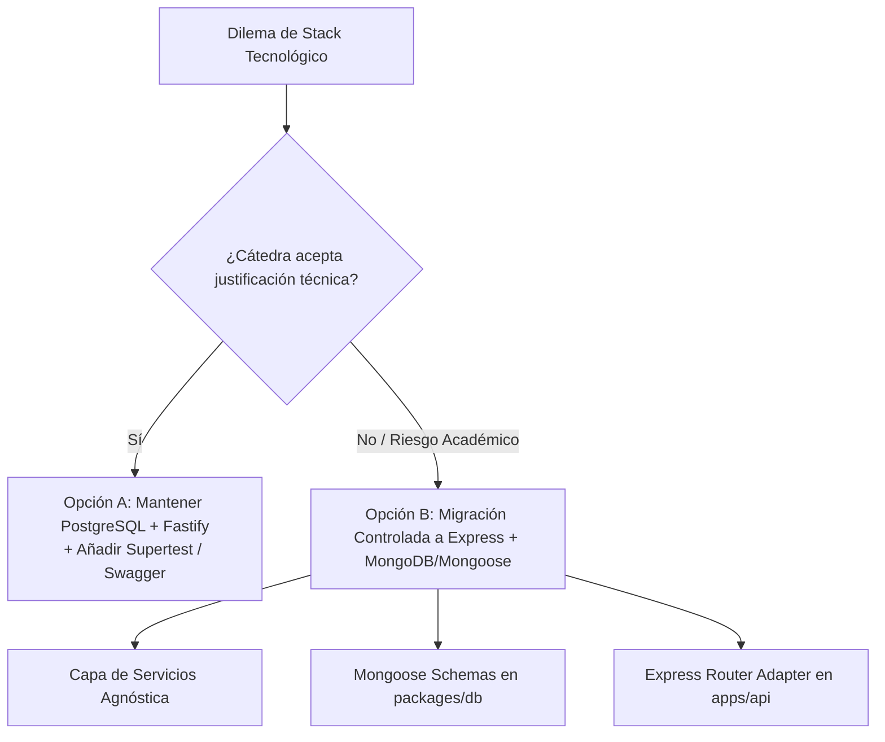
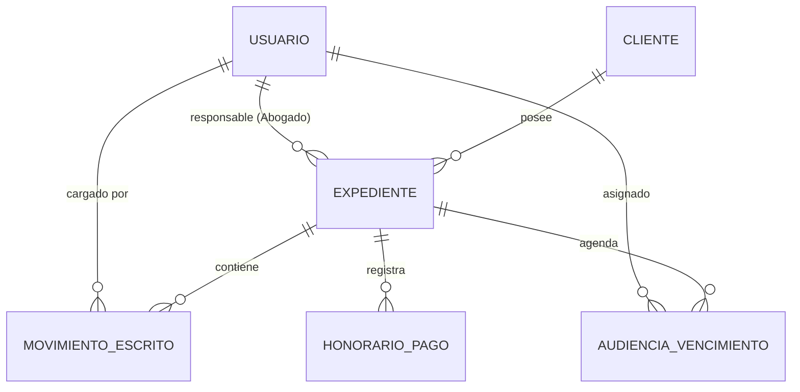
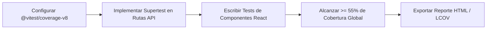
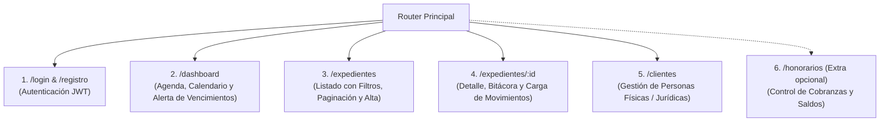
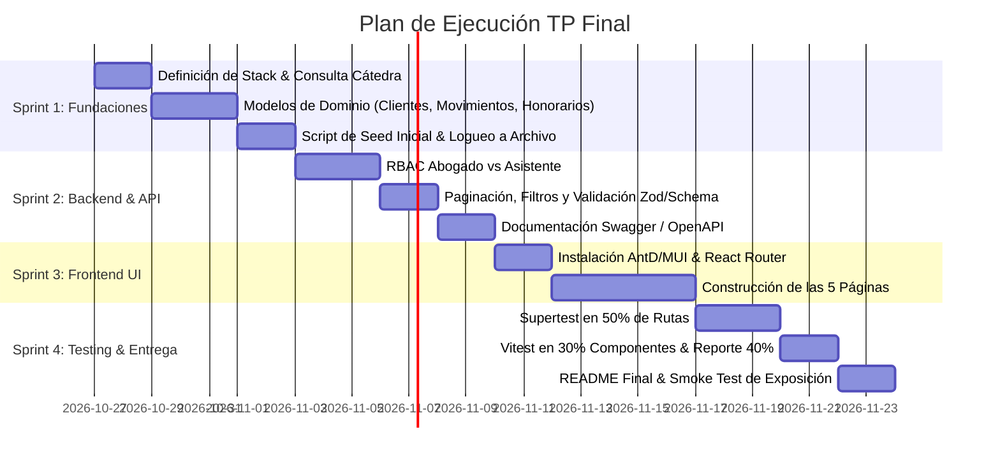

# GAP ANALYSIS REPORT: SZLIT vs. TP FINAL PROGRAMACIÓN III (ESTUDIO JURÍDICO)

> **Auditoría Técnica y Arquitectura de Software**  
> **Proyecto:** SZLIT (SECHUB) — Sistema de Gestión para Estudio Jurídico  
> **Cátedra:** Programación III (2026) — Prof. Ing. Gastón A. Larriera (UTN)  
> **Fecha de Emisión:** 26 de Octubre de 2026  
> **Estado:** Documento de Planificación y Arquitectura  

---

## Resumen Ejecutivo

El presente informe constituye un **Análisis de Brechas (Gap Analysis)** técnico y metodológico entre la base de código actual del proyecto **SZLIT** (un monorepo TypeScript para gestión de expedientes laborales y audiencias SECLO) y los requerimientos obligatorios fijados en la rúbrica del **Trabajo Práctico Final de Programación III**.

SZLIT cuenta con una base de ingeniería madura (tipado estricto con TypeScript, migraciones deterministas, separación monorepo `apps/api`, `apps/web`, `packages/db`, y pruebas automatizadas). No obstante, existen **fricciones de stack tecnológico**, **discrepancias en el modelo de dominio** y **carencias frontend y de cobertura** que deben subsanarse metódicamente para garantizar la aprobación sin observaciones de la cátedra.

---

## 1. Inventario de Reutilización de Dominio

SZLIT posee componentes de dominio que resuelven problemas reales del fuero judicial argentino. Podemos capitalizar gran parte de este trabajo sin degradar la arquitectura:

| Componente Actual (SZLIT) | Ubicación | Estado Actual | Adaptación al Requisito del TP Final | Potencial de Reutilización |
| :--- | :--- | :--- | :--- | :--- |
| **Carpetas / Expedientes** | `packages/db/src/schema/carpetas.ts`<br>`apps/api/src/routes/carpetas.ts` | Gestión de carátula, número de expediente, estado de caso, concurrencia optimista (`version`). | Se adapta como la entidad núcleo **Expediente**. Requiere agregar los campos `clienteId`, `abogadoResponsableId` y `fuero`. | **Alta (85%)** |
| **Audiencias & Agenda** | `packages/db/src/schema/audiencias.ts`<br>`apps/api/src/routes/audiencias.ts` | Fecha, hora, tipo de audiencia, link de reunión, notas, bandeja de huérfanas (`orphan tray`). | Cubre el 90% del requerimiento de Agenda. Requiere incorporar el concepto de **vencimientos judiciales** y alerta visual de próximos a vencer. | **Alta (90%)** |
| **Bitácora de Carpetas** | `packages/db/src/schema/carpetas.ts` (`bitacoraCarpetas`) | Auditoría de acciones automáticas en expedientes con usuario y timestamp. | Sirve de base para la entidad requerida **Movimientos y Escritos**, permitiendo a abogados y asistentes cargar notas procesales. | **Media (60%)** |
| **Empleadores** | `packages/db/src/schema/empleadores.ts` | CUIT, razón social, contactos, poderes, alertas. | Representa a la demandada. Puede generalizarse o relacionarse con la nueva entidad **Clientes** (persona física o jurídica). | **Media (50%)** |
| **Actas SECLO / Linking** | `packages/db/src/schema/actas.ts`<br>`apps/api/src/acta-linking.ts` | Transacciones ACID para vinculación de actas con audiencias y carpetas. | Funcionalidad avanzada diferenciadora para la defensa oral del proyecto. | **Alta (95%)** |
| **Mockup UI (`szlit-app.html`)** | `szlit-app (14).html` | Maqueta HTML interactiva con vistas de Carátulas, Calendario, Agenda Diaria y Avisos. | Guía visual y de experiencia de usuario directa para estructurar las 5 pantallas en React. | **Alta (80%)** |

---

## 2. Conflicto Crítico de Stack Tecnológico

El documento de la cátedra fija taxativamente el siguiente stack:
- **Base de Datos:** MongoDB
- **Backend:** Express.js + Node.js + TypeScript
- **Frontend UI:** React.js con AntD, Chakra UI o MaterialUI
- **Pruebas:** Vitest / Jest con Supertest en integración (>= 50% de rutas)

En contraste, SZLIT fue concebido con:
- **Base de Datos:** PostgreSQL con Drizzle ORM
- **Backend:** Fastify (con validación JSON Schema)
- **Frontend UI:** React 19 con estilos CSS propios (sin biblioteca UI)
- **Pruebas:** Fastify `app.inject()` (sin Supertest)

### Evaluación de Opciones y Veredicto Arquitectónico



### Opción A: Defensa Técnica de PostgreSQL y Fastify (Recomendada con Consulta Previa)
* **Argumentación ante el Docente:**
  1. **Integridad Relacional vs. Documental:** Un estudio jurídico opera sobre expedientes donde las audiencias, movimientos, clientes y pagos requieren integridad referencial estricta y transacciones ACID. La desnormalización en MongoDB propicia inconsistencias huérfanas ante cancelaciones o reasignaciones de expedientes.
  2. **Performance y Modernidad:** Fastify ofrece un rendimiento 2 a 3 veces superior a Express y maneja validación nativa estricta por esquema.
  3. **El documento permite consulta:** La consigna estipula: *"se puede consultar al docente del curso para resolver las dudas que tengan los alumnos"*.
* **Riesgo:** Si el criterio del evaluador es dogmático o ejecutan tests de corrección automatizada atados a Mongoose, el proyecto queda descalificado formalmente.

### Opción B: Migración a Express + MongoDB (Ruta Segura de Rúbrica)
Si la cátedra exige cumplimiento ciego de la consigna:
* **Capas Afectadas:**
  1. `packages/db`: Reemplazar modelos Drizzle por esquemas de Mongoose (`Usuario`, `Cliente`, `Expediente`, `Movimiento`, `Audiencia`, `Honorario`). Configurar script de seed inicial con `mongoose.connection`.
  2. `apps/api`: Reemplazar instancias de Fastify por `express.Router()`. Adaptar middlewares de autenticación JWT y autorización.
* **Estimación de Esfuerzo:** 16 a 22 horas de trabajo concentrado (1 Sprint).

> **Estrategia Recomendada:** Desacoplar la lógica de negocio en **Servicios de Dominio** puros en TypeScript. De este modo, los controladores (sean de Fastify o Express) solo consumen casos de uso (`crearExpedienteService()`, `listarAgendaService()`), desacoplando el framework HTTP de la base de datos.

---

## 3. Mapeo de Entidades y Roles

### A. Entidades Mínimas (Mínimo 4 Requeridas en Backend)

El TP exige un mínimo de 4 entidades con relaciones concretas. El modelo estructurado para cumplir la totalidad del dominio de un estudio jurídico es:



1. **`Usuario` (Existente, a enriquecer):**
   - Campos: `id`, `email`, `nombre`, `rol` (`ABOGADO` | `ASISTENTE`), `passwordHash`, `activo`.
2. **`Cliente` (Nueva - Faltante):**
   - Campos: `id`, `tipo` (`PERSONA_FISICA` | `PERSONA_JURIDICA`), `nombreRazonSocial`, `cuitDni`, `email`, `telefono`, `domicilio`.
3. **`Expediente` (Mapeado desde `carpetas`):**
   - Campos: `id`, `numeroExpediente`, `caratula`, `fueroMateria` (Laboral, Civil, Comercial), `clienteId` (FK), `abogadoResponsableId` (FK), `estado` (`EN_TRAMITE`, `EN_ESPERA`, `ARCHIVADO`).
4. **`MovimientoEscrito` (Nueva - Faltante):**
   - Campos: `id`, `expedienteId` (FK), `fecha`, `tipo` (`ESCRITO`, `RESOLUCION`, `NOTIFICACION`, `CEDULA`), `descripcion`, `usuarioId` (FK).
5. **`AudienciaVencimiento` (Mapeado desde `audiencias`):**
   - Campos: `id`, `expedienteId` (FK opcional/huérfana), `abogadoId` (FK), `tipo` (`AUDIENCIA` | `VENCIMIENTO`), `fecha`, `hora`, `estado`, `avisoProximo`.
6. **`HonorarioPago` (Nueva - Faltante):**
   - Campos: `id`, `expedienteId` (FK), `montoPactado`, `montoPagado`, `fechaPago`, `concepto`, `saldoPendiente`.

### B. Matriz de Control de Acceso Basado en Roles (RBAC)

La consigna exige textualmente:
> *"Un abogado ve sus expedientes y su agenda; un asistente puede cargar movimientos, audiencias y clientes de cualquier expediente."*

| Acción / Módulo | Rol: ABOGADO | Rol: ASISTENTE | Regla de Autorización Técnica |
| :--- | :---: | :---: | :--- |
| **Ver Expedientes** | Solo los propios | Todos | `WHERE abogadoResponsableId = req.user.id` (si es Abogado) |
| **Ver Agenda / Audiencias** | Solo las propias | Todas | `WHERE abogadoId = req.user.id` (si es Abogado) |
| **Cargar Clientes** | Permitido | Permitido | Sin restricción por rol |
| **Cargar Movimientos** | En sus expedientes | En cualquier expediente | Asistente escribe global; Abogado solo en asignados |
| **Cargar Audiencias** | En sus expedientes | En cualquier expediente | Asistente agenda para cualquier colega |
| **Registrar Honorarios / Pagos** | Permitido | Solo lectura / Restringido | Control fino en endpoint `/api/honorarios` |

---

## 4. Plan de Cobertura de Tests y Calidad

### Diagnóstico Actual
* **Cobertura General:** Desconocida cuantitativamente (no hay reporte LCOV/v8 configurado en el pipeline).
* **Backend:** 60 tests en Fastify usando `app.inject()`. No se utiliza la librería `supertest` exigida por la consigna.
* **Frontend:** 18 tests en 4 archivos básicos (Auth, Login, Config, API). No hay tests de pantallas ni de componentes de UI de negocio.

### Requisitos Mandatarios de la Rúbrica
1. **Reporte de Coverage:** Mínimo **40% de statements**, exportado y entregado con el repositorio (`coverage/`).
2. **Supertest:** Mínimo **50% de las rutas HTTP** del backend testeadas con Supertest.
3. **Tests de Componentes:** Mínimo **30% de los componentes React** testeados con Vitest + Testing Library.

### Plan de Acción Inmediato


1. **Configuración de Cobertura:**
   - Instalar `@vitest/coverage-v8` en el proyecto.
   - Modificar `vitest.config.ts` incorporando:
     ```ts
     coverage: {
       provider: 'v8',
       reporter: ['text', 'json', 'html', 'lcov'],
       lines: 45,
       statements: 45,
       functions: 40,
       branches: 40,
     }
     ```
2. **Supertest en Backend (50% de rutas):**
   - Si se mantiene Fastify: montar el servidor en modo `fastify.server` y pasar a `supertest(app.server)`.
   - Si se migra a Express: `supertest(app)` estándar sobre los endpoints principales:
     * `POST /api/auth/login` (200, 401)
     * `GET /api/expedientes` (Filtro por rol Abogado vs Asistente)
     * `POST /api/clientes` (Validación de datos, 201, 400)
     * `POST /api/audiencias` (201, validación de fechas)
     * `POST /api/movimientos` (Asistente en cualquier caso)
3. **Vitest en Frontend (30% de componentes):**
   - Testear `Login.tsx`, `ExpedienteCard.tsx`, `TablaPaginada.tsx`, `FormClienteModal.tsx`, `AlertaVencimientos.tsx`.

---

## 5. Matriz de Brechas y Faltantes (GAP Matrix)

La siguiente tabla resume todos los elementos faltantes que deben construirse desde cero:

| Ítem de la Rúbrica | Estado en SZLIT | Severidad | Acción Requerida |
| :--- | :--- | :---: | :--- |
| **Librería de UI** | Inexistente (CSS plano) | **Crítica** | Instalar **Ant Design (AntD)** o **Chakra UI** / **MaterialUI**. Migrar estilos y formularios. |
| **Ruteo Frontend (5 páginas)** | Inexistente (Solo 1 vista estática) | **Crítica** | Instalar `react-router-dom` y crear las 5 páginas obligatorias con navegación protegida por rol. |
| **Paginación y Filtros** | Inexistente (Retorna arrays completos) | **Alta** | Implementar `page`, `limit`, y filtros (`estado`, `q`, `abogadoId`) en listado de expedientes y clientes. |
| **Entidad: Clientes** | Inexistente | **Alta** | Crear modelo, migraciones/esquema y endpoints CRUD para Personas Físicas y Jurídicas. |
| **Entidad: Movimientos/Escritos** | Inexistente | **Alta** | Crear CRUD para asentar escritos judiciales vinculados a expedientes. |
| **Entidad: Honorarios y Pagos** | Inexistente | **Alta** | Crear modelo y formulario de pactos de honorarios y cobros por expediente. |
| **Vencimientos y Alertas** | Inexistente | **Media** | Algoritmo que detecte audiencias o plazos a vencer en los próximos 7 días y muestre alerta destacada. |
| **Documentación API** | Inexistente | **Media** | Generar especificación OpenAPI/Swagger interactiva con Swagger UI y exportar colección Postman/Insomnia. |
| **Logueo de Errores** | Solo consola | **Media** | Configurar logger estructurado (Pino/Winston) que registre errores en archivos físicos (`logs/error.log`). |
| **Migración Inicial / Seeds** | SQL básico de dev | **Alta** | Crear script idempotente de seed (`seed:initial`) con datos verosímiles de abogados, asistentes y casos. |
| **README con Instrucciones** | Desactualizado | **Baja** | Redactar guía paso a paso para levantar backend, frontend, base de datos y correr tests localmente. |

---

## 6. Especificación de las 5 Páginas Mínimas con Ruteo

Para cumplir holgadamente la exigencia de frontend con Ant Design o Material UI, la aplicación se organizará en las siguientes 5 rutas principales:



1. **Página 1: Login & Registro (`/login`, `/registro`)**
   - Formulario validado con AntD/MUI. Almacenamiento seguro del JWT en `localStorage` o cookie.
2. **Página 2: Dashboard & Agenda (`/dashboard` o `/agenda`)**
   - Vista unificada de audiencias próximas. Alerta destacada (badge rojo) de **vencimientos en las próximas 48/72 horas**.
3. **Página 3: Catálogo de Expedientes (`/expedientes`)**
   - Tabla con **paginación server-side**, búsqueda por carátula, filtro por estado (`En trámite`, `En espera`, `Archivado`) y fuero.
4. **Página 4: Detalle de Expediente & Movimientos (`/expedientes/:id`)**
   - Ficha técnica del caso, datos del cliente, y panel para que el Asistente o Abogado cargue nuevos escritos y movimientos.
5. **Página 5: Administración de Clientes (`/clientes`)**
   - Listado y formulario modal de alta de clientes con validación de CUIT/DNI, teléfono y correo electrónico.

---

## 7. Plan de Ejecución por Sprints (Roadmap)

Se propone un plan de acción dividido en 4 Sprints secuenciales para una ejecución disciplinada:



### Sprint 1: Fundaciones de Datos y Autenticación (Días 1 a 4)
- [ ] Resolver definición final de BD (Consulta con cátedra sobre PostgreSQL vs. MongoDB).
- [ ] Implementar/adaptar entidades: `Cliente`, `Expediente`, `Movimiento`, `Audiencia`, `Honorario`.
- [ ] Implementar roles obligatorios: `ABOGADO` y `ASISTENTE` con autenticación JWT limpia.
- [ ] Crear script de seed de datos iniciales (`pnpm db:seed`) con casos de prueba listos para la defensa oral.
- [ ] Configurar transporte de logueo de errores en archivos físicos (`logs/error.log`).

### Sprint 2: Lógica de Negocio y Endpoints Documentados (Días 5 a 8)
- [ ] Implementar endpoints con permisos diferenciales:
  - Abogado solo consulta sus casos y su agenda.
  - Asistente puede crear clientes, movimientos y audiencias en cualquier expediente.
- [ ] Agregar paginación (`page`, `limit`) y filtros multicriterio en `/api/expedientes`.
- [ ] Implementar alerta de vencimientos próximos (< 7 días).
- [ ] Configurar Swagger/OpenAPI en `/api/docs` con códigos de estado HTTP semánticos.

### Sprint 3: Frontend con Librería de UI y Ruteo (Días 9 a 13)
- [ ] Incorporar biblioteca UI requerida (**Ant Design** recomendada por velocidad en tablas y formularios administrativos).
- [ ] Configurar `react-router-dom` con rutas privadas y control de vistas por rol.
- [ ] Implementar las 5 pantallas operativas: Login, Dashboard/Agenda con alertas, Listado de Expedientes paginado, Detalle de Expediente con carga de movimientos, y Gestión de Clientes.

### Sprint 4: Calidad, Testing y Preparación de Defensa (Días 14 a 17)
- [ ] Implementar pruebas de integración con **Supertest** cubriendo >= 50% de los endpoints.
- [ ] Implementar pruebas unitarias y de componentes en **Vitest** cubriendo >= 30% de los componentes frontend.
- [ ] Ejecutar reporte de cobertura asegurando **>= 40% de statements** y exportarlo en el repositorio.
- [ ] Redactar `README.md` exhaustivo con instrucciones para levantar el sistema en un comando y correr la migración/seed.
- [ ] Smoke test integral previo a la fecha de entrega.

---

> **Conclusión del Auditor:**  
> SZLIT posee una arquitectura sólida sobre la cual apalancarse. La clave del éxito para la entrega del TP radica en **no subestimar las condiciones formales de la consigna** (Librería UI, 5 pantallas, roles específicos y reporte de cobertura al 40%). Siguiendo este plan por sprints, el proyecto no solo alcanzará la aprobación sino que destacará con una nota sobresaliente en la defensa oral.
